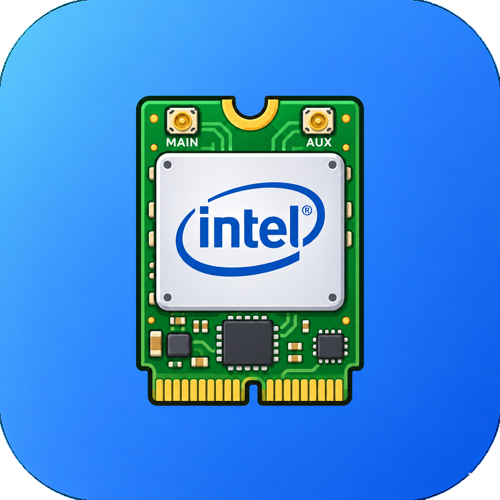

<h1 align="center">AirportIntel</h1>

<em>因为Intel Wi-Fi无法进行隔空投送，所以我做了这个Kext</em>

**在 macOS 14.8.9上为 Intel Wi-Fi 网卡实现 AirDrop 功能。** AirportIntel 是 AirportItlwm 的一个分支版本，它引入了 AWDL（即 AirDrop 所依赖的点对点 Wi-Fi 链路技术）。其余功能则由苹果原生的 Wi-Fi 协议栈负责处理。在使用 AirDrop 的同时，正常的 Wi-Fi 连接依然可以保持畅通。

## ⚠️ 温馨提示：

> AirportIntel 运行在macOS 内核中，程序中的缺陷可能会导致内核崩溃（Kernel Panic）、系统无限重启、Wi-Fi 或蓝牙功能丢失、数据传输失败，甚至导致“黑苹果”（Hackintosh）系统无法通过该 EFI 配置引导启动。本软件不提供任何形式的保证，对于由此产生的任何损坏或数据丢失，本人概不负责。

> [!IMPORTANT]
> 本项目在开发过程中使用了人工智能（AI）技术。** 驱动程序代码、逆向工程分析以及测试工具，大部分是在 AI（Claude，WorkBuddy）的辅助下编写完成的。本人并非专业的内核开发人员。尽管我对开发过程进行了密切监控与指导，并对代码进行了深入研究、审核及硬件实机测试，但 AI 编写的代码仍可能包含在有限的测试环境下无法被发现的错误。如果您不希望运行由 AI 辅助编写的内核代码，请勿安装本软件。

- 在运行本程序之前请您务必备份您的EFI
- 请先运行[兼容性检查工具](#will-it-work-on-my-hackintosh)。
- 在更新 macOS 系统之前，请使用原版AIrportltwm.kext引导启动一次系统否则，增量更新可能会失败。

## 功能：

在项目的测试设备（AX210、macOS 14.8.9、iPhone 12 Pro）上，且全程保持连接至常规 5 GHz Wi-Fi 网络的情况下：

|                                     | 结果                                           |
| ----------------------------------- | ---------------------------------------------- |
| Mac → iPhone                        | 传输速度约 12 MB/s，连接耗时 1 至 3秒          |
| iPhone → Mac                        | 传输速度约 11 MB/s，首次建立连接通常需 1至 5秒 |
| 接力，通用剪切板                    | 正常工作                                       |
| 通过 Wi-Fi 使用 iMessage 和推送功能 | 正常工作                                       |

速度取决于 iPhone 自身的 Wi-Fi 状态：在未连接 Wi-Fi 或连接至 149 信道时可达到全速；若连接至其他信道且该信道繁忙，速度则会降低。

## 支持的 macOS 版本及网卡

| macOS  | Builds         | AirDrop  |
| ------ | -------------- | -------- |
| Sonoma | 14.8.9，测试版 | 工作正常 |

在其他任何版本中，驱动程序都会保持 AirDrop 关闭状态，仅作为普通 Wi-Fi 使用。

**网卡：** 理论上来说Airportltwm支持的网卡本驱动都支持，但本项目近测试了Intel AX210

**请勿使用任何OCLP的Wi-Fi补丁！** AirportIntel依赖于 macOS 原生的 Wi-Fi 协议，如果您应用过 OpenCore Legacy Patcher (OCLP) 的“现代无线网络”(Modern Wireless) 根补丁，请将其撤销，并删除 `config.plist` 中由该补丁添加的相关内容。若保留这些补丁，将导致 Wi-Fi 无法启动。

## 安装

在 EFI 分区中，将 `AirportItlwm.kext` 替换为适用于您所用 macOS 版本的 `AirportIntel.kext`，把 `IntelBTPatcher.kext` 替换成`BTLEAdvFixup.kext`然后重启系统。请勿同时加载 `AirportItlwm` 和 `AirportIntel`。

## 安装后：测试内容

从 USB 启动盘引导系统，连接 Wi-Fi 网络，稍等片刻，然后进行以下检查：

1. **驱动程序运行情况：** 执行 `bash tools/compat/check_compat.sh`，确认 AirDrop 构建版本正在运行，且网卡和蓝牙状态均显示正常（OK）。
2. **Wi-Fi 功能：** 尝试浏览网页，并进行网速测试。
3. **蓝牙功能：** 确认蓝牙已开启；执行 `ioreg -l -w0 -d1 | grep '"BTLEAdvHookRouted'`，结果应显示为 1。
4. **AirDrop 通道：** 执行 `ioreg -l -w0 | grep '"ITLAWDLCoexChannel"'`，结果应显示为 149（若显示为 6，则表示速度较慢）。
5. **AirDrop 双向传输：** 分别从 Mac 向 iPhone 发送大文件，以及从 iPhone 向 Mac 发送大文件。在此过程中运行 `bash tools/compat/airdrop_measure.sh`，以查看传输速度和连接耗时。
6. **iMessage：** 在 Mac 上尝试发送和接收 iMessage 信息。如果无法使用，可执行 `printf 'show State:/Network/Interface/en0/LinkQuality\n' | scutil`，结果应显示为 100（信号较弱时可能显示为 50 或 10）

## 已知局限性

- **在某些配置下，从 Mac 到 iPhone 的传输速度可能远慢于从 iPhone 到 Mac 的传输速度
- **连接过程可能较慢，** 这种情况多见于从 iPhone 连接到 Mac 时。
- **当 AirDrop 处于监听状态时，常规 Wi-Fi 的速度会有所下降**（因为它们共用同一个无线模块）。

## 如果睡眠唤醒后/长时间运行系统隔空投送失效

- 请安装Awdl Watch Dog工具，安装说明请参阅[Awdl Watch Dog安装说明](https://github.com/Kaixi2004/AirportIntel/tree/main/tools/awdl-watchdog/使用安装说明.md)

## 致谢

AirportIntel的开发建立在许多前人的工作基础之上：

- **[Forbiddenltlwm](https://github.com/retropineaple/ForbiddenItlwm)**基于此链接项目的代码适配并修复已知问题。
- **[itlwm / AirportItlwm](https://github.com/OpenIntelWireless/itlwm)**（由 zxystd 及 OpenIntelWireless 贡献者开发）：这是本项目所基于的英特尔（Intel）Wi-Fi 驱动程序。
- **kgp-macPro/AirportItlwm-Tahoe**：根据基础代码中的注释，该项目为本项目的 DMA 设计提供了参考。
- **[OpenBSD](https://www.openbsd.org)**：提供了 net80211 框架以及 iwx、iwm 和 iwn 驱动程序。
- **[Linux iwlwifi](https://wireless.wiki.kernel.org/en/users/drivers/iwlwifi)** 及 **Intel**：提供了固件并作为参考资料（本项目未直接复制任何代码）。
- **[FranciumOS-org/AirPort_RTW89](https://github.com/FranciumOS-org/AirPort_RTW89)** (GPL-2.0)：该项目展示了实现思路，并被用于交叉验证传输格式（wire format）。
- **[seemoo-lab/owl](https://github.com/seemoo-lab/owl)** 及其“开放无线链路”（Open Wireless Link）研究：用于交叉验证 AWDL 帧格式和时序（本项目未直接复制任何代码）。
- **[Acidanthera](https://github.com/acidanthera)**：提供了 Lilu、MacKernelSDK 和 BlueToolFixup。其中 BTLEAdvFixup 的页面挂钩（page hook）机制参考了 BlueToolFixup 的实现。 - **[IntelBluetoothFirmware / IntelBTPatcher](https://github.com/OpenIntelWireless/IntelBluetoothFirmware)** (GPL-3.0)：BTLEAdvFixup 中的 HCI 钩子（hook）实现参考了 IntelBTPatcher。
- 开发过程中参考了 Apple 的 XNU 源代码。

AirportIntel 与 A​​pple 或 Intel 均无关联，也未得到其认可。AirDrop 是 Apple Inc. 的商标。

## 许可协议

- **Wi-Fi 驱动程序：** 采用 GPL-2.0 协议，详见 [LICENSE](LICENSE)。源自 OpenBSD 的文件保留其原有的 ISC 和 BSD 版权声明。
- **BTLEAdvFixup：** 采用 GPL-3.0 协议，详见 [BTLEAdvFixup/LICENSE](BTLEAdvFixup/LICENSE)。
- **`itlwm/firmware` 目录下的 Intel 固件：** 遵循 Intel 的再分发许可协议，详见 [iwlwifi-firmware-license](iwlwifi-firmware-license)。
